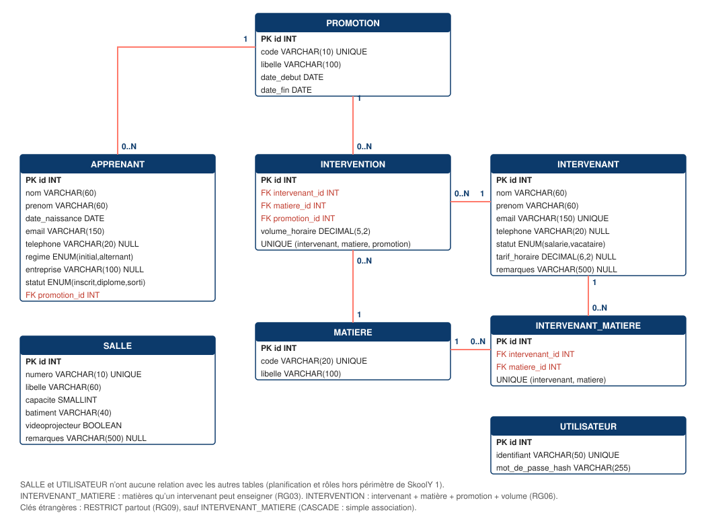

# 1. Vue d'ensemble

La base **skooly** (MySQL / MariaDB, moteur **InnoDB**, jeu de caractères **utf8mb4**, collation `utf8mb4_unicode_ci`) contient 7 tables. Chaque table a une clé primaire technique auto-incrémentée `id`, chaque relation est portée par une clé étrangère, et les contraintes (`UNIQUE`, `CHECK`, `NOT NULL`, `ENUM`) empêchent réellement d'enregistrer une donnée absurde, même si l'application était contournée.

# 2. Description des tables

## promotion

| Colonne | Type | Contraintes |
|---|---|---|
| id | INT UNSIGNED | PK, auto-incrément |
| code | VARCHAR(10) | NOT NULL, UNIQUE (ex. « DCG 1 ») |
| libelle | VARCHAR(100) | NOT NULL |
| date_debut | DATE | NOT NULL |
| date_fin | DATE | NOT NULL, CHECK `date_fin > date_debut` |

## apprenant

| Colonne | Type | Contraintes |
|---|---|---|
| id | INT UNSIGNED | PK, auto-incrément (RG02) |
| nom, prenom | VARCHAR(60) | NOT NULL |
| date_naissance | DATE | NOT NULL (RG08) |
| email | VARCHAR(150) | NOT NULL, **non unique** (RG02) |
| telephone | VARCHAR(20) | NULL autorisé |
| regime | ENUM('initial','alternant') | NOT NULL, défaut `initial` |
| entreprise | VARCHAR(100) | NULL ; CHECK : obligatoire si `regime = 'alternant'` |
| statut | ENUM('inscrit','diplome','sorti') | NOT NULL, défaut `inscrit` |
| promotion_id | INT UNSIGNED | NOT NULL, FK → promotion(id), RESTRICT (RG01) |

## intervenant

| Colonne | Type | Contraintes |
|---|---|---|
| id | INT UNSIGNED | PK, auto-incrément |
| nom, prenom | VARCHAR(60) | NOT NULL |
| email | VARCHAR(150) | NOT NULL, **UNIQUE** (RG07) |
| telephone | VARCHAR(20) | NULL autorisé |
| statut | ENUM('salarie','vacataire') | NOT NULL (RG04) |
| tarif_horaire | DECIMAL(6,2) | NULL ; CHECK : `NULL` pour un salarié, `> 0` pour un vacataire (RG04, RG08) |

## matiere

| Colonne | Type | Contraintes |
|---|---|---|
| id | INT UNSIGNED | PK, auto-incrément |
| code | VARCHAR(10) | NOT NULL, UNIQUE |
| libelle | VARCHAR(100) | NOT NULL |

*Pas de volume horaire ici : il dépend de la promotion (RG06).*

## salle

| Colonne | Type | Contraintes |
|---|---|---|
| id | INT UNSIGNED | PK, auto-incrément |
| numero | VARCHAR(10) | NOT NULL, UNIQUE |
| libelle | VARCHAR(60) | NOT NULL |
| capacite | SMALLINT UNSIGNED | NOT NULL, CHECK `capacite > 0` |
| batiment | VARCHAR(40) | NOT NULL |
| videoprojecteur | BOOLEAN | NOT NULL, défaut 0 (RG08) |
| remarques | VARCHAR(500) | NULL autorisé (ajout de l'équipe, voir décision 17) |

## intervention

| Colonne | Type | Contraintes |
|---|---|---|
| id | INT UNSIGNED | PK, auto-incrément |
| intervenant_id | INT UNSIGNED | NOT NULL, FK → intervenant(id), RESTRICT |
| matiere_id | INT UNSIGNED | NOT NULL, FK → matiere(id), RESTRICT |
| promotion_id | INT UNSIGNED | NOT NULL, FK → promotion(id), RESTRICT |
| volume_horaire | DECIMAL(5,2) | NOT NULL, CHECK `> 0` (RG06, RG08) |
| | | UNIQUE (intervenant_id, matiere_id, promotion_id) |

## utilisateur

| Colonne | Type | Contraintes |
|---|---|---|
| id | INT UNSIGNED | PK, auto-incrément |
| identifiant | VARCHAR(50) | NOT NULL, UNIQUE |
| mot_de_passe_hash | VARCHAR(255) | NOT NULL — empreinte `password_hash()`, jamais le mot de passe |

# 3. Relations

| Relation | Cardinalité | Règle |
|---|---|---|
| promotion — apprenant | 1 — 0..N | RG01 : un apprenant a une promotion et une seule ; une promotion peut être vide |
| intervenant — intervention | 1 — 0..N | RG05 : un intervenant peut n'avoir aucune intervention |
| matiere — intervention | 1 — 0..N | |
| promotion — intervention | 1 — 0..N | |
| intervenant — matiere | N — N (via `intervention`) | RG03 |

# 4. Justification des décisions non imposées (RG10)

| # | Décision | Justification |
|---|---|---|
| 1 | Clé primaire technique `INT UNSIGNED AUTO_INCREMENT` partout | Imposé par le sujet ; évite d'utiliser un code ou un e-mail comme identité (RG02). |
| 2 | **Le volume horaire est sur `intervention`**, pas sur `matiere` | Le volume dépend de la promotion *et* de l'intervenant (RG06). Le volume d'une matière dans une promotion est la **somme** de ses interventions. |
| 3 | **Pas de table `intervenant_matiere`** : « Intervenant enseigne Matière » (RG03) est déduit des interventions | Évite une table redondante qui pourrait se contredire avec `intervention`. Conséquence assumée : un intervenant n'« enseigne » une matière qu'à partir de sa première intervention. |
| 4 | `UNIQUE (intervenant, matière, promotion)` sur `intervention` | Interdit le même triplet deux fois ; on modifie un volume en supprimant puis recréant. |
| 5 | `regime`, `statut` en **ENUM** (et non table de référence) | Listes courtes et figées par le cahier des charges ; la base refuse toute autre valeur. Ajouter une valeur demandera un `ALTER TABLE`. |
| 6 | `CHECK` sur `entreprise` (alternant) et `tarif_horaire` (vacataire / salarié) | La règle vit dans la base : aucune page, script ou saisie dans phpMyAdmin ne peut la contourner. |
| 7 | `apprenant.email` **non unique**, `intervenant.email` **unique** | RG02 (e-mail de parent partagé) et RG07. |
| 8 | `code` unique sur promotion et matière, `numero` unique sur salle | Ce sont les identifiants « métier » affichés ; deux salles « 101 » n'auraient aucun sens. |
| 9 | `salle.numero` en **VARCHAR** et non en entier | Un numéro comme « 012 » perdrait son zéro ; ce n'est pas une quantité. |
| 10 | `telephone` en **VARCHAR(20)**, format normalisé `06 12 34 56 78`, facultatif | Un téléphone n'est pas un nombre (zéro initial, +33). Facultatif : une donnée absente ne doit pas bloquer une inscription. |
| 11 | `tarif_horaire DECIMAL(6,2)`, `volume_horaire DECIMAL(5,2)` | RG08 : jamais de texte ni de flottant pour un montant. Le volume accepte les demi-heures (12,5 h). |
| 12 | Toutes les clés étrangères en `ON DELETE RESTRICT` | RG09 : la base refuse la suppression même si l'application était contournée ; l'application affiche en plus un message compréhensible. |
| 13 | `CHECK date_fin > date_debut` sur promotion | Une promotion ne peut pas finir avant d'avoir commencé. |
| 14 | `mot_de_passe_hash VARCHAR(255)` | `password_hash` peut produire des empreintes plus longues si l'algorithme par défaut évolue. |
| 15 | `utf8mb4_unicode_ci` | Accents, apostrophes et symboles (« Zoé », « O'Neil & Fils ») ; recherche insensible à la casse et aux accents. |
| 16 | Hormis la décision 17, aucune colonne ajoutée au-delà du minimum du sujet | Le périmètre de SkoolY 1 est volontairement petit ; les phases suivantes enrichiront le schéma. |
| 17 | Ajout de `salle.remarques` `VARCHAR(500) NULL` | Besoin du Campus : noter l'état du matériel ou une particularité d'accès. Facultatif (NULL si vide, jamais une chaîne vide) ; 500 caractères maximum, contrôlés côté serveur ; une base existante se met à jour avec `sql/migrations/001_salle_remarques.sql`. |

# 5. Décisions applicatives (hors base)

| Décision | Valeur retenue |
|---|---|
| Taille de page des listes | 15 lignes (10 pour les listes intégrées à une fiche) |
| Recherche | Dès 3 caractères, sur nom, prénom et e-mail (« contient ») ; en dessous de 3, un avertissement s'affiche et la recherche est ignorée |
| Filtres des apprenants | Promotion, régime, statut — combinables entre eux et avec la recherche |
| Saisie des dates | Texte `JJ/MM/AAAA` (le sélecteur natif empêcherait de démontrer le contrôle « 31 février ») ; stockage `AAAA-MM-JJ` |
| Âge minimal d'un apprenant | 14 ans ; année de naissance minimale 1940 |
| Suppression | Page de confirmation côté serveur (fonctionne sans JavaScript), requête `POST` avec jeton CSRF |
| Jeton CSRF | Sur tous les formulaires `POST` (au-delà du minimum du sujet, pour un coût très faible) |
| Messages d'erreur de connexion | Identiques que l'identifiant existe ou non |
